

  <a href="https://lakshyasachdevaportfolio.vercel.app/" target="_blank">
    
  </a>

  

---

### `lakshya.exe`

  <a href="https://binarycoder3012.github.io/Binarycoder3012/" target="_blank">
  <picture>
    <source media="(prefers-color-scheme: dark)" srcset="profile_dark.svg?v=14">
    <source media="(prefers-color-scheme: light)" srcset="profile_light.svg?v=14">
    
  </picture>
  </a>
    
  

---

### Projects

<table>
  <tr>
    <td width="50%" align="center">
      <a href="https://cortexorbit.vercel.app" target="_blank">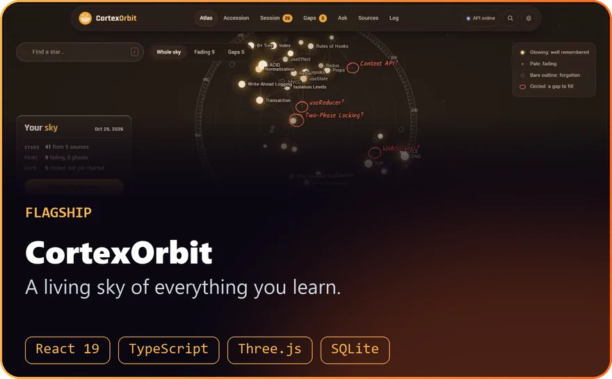</a>
       
      
      
    </td>
    <td width="50%" align="center">
      <a href="https://data-vault-phi-eight.vercel.app/" target="_blank">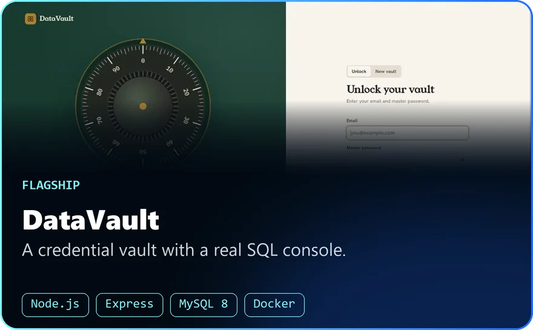</a>
       
      
    </td>
  </tr>
  <tr>
    <td width="50%" align="center">
      <a href="https://onyx-os-plum.vercel.app" target="_blank">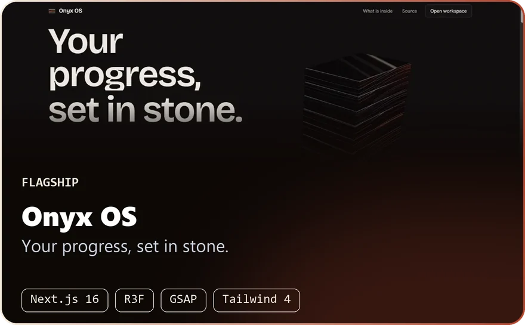</a>
       
      
      
    </td>
    <td width="50%" align="center">
      <a href="https://lakshya-gram-v2.vercel.app" target="_blank">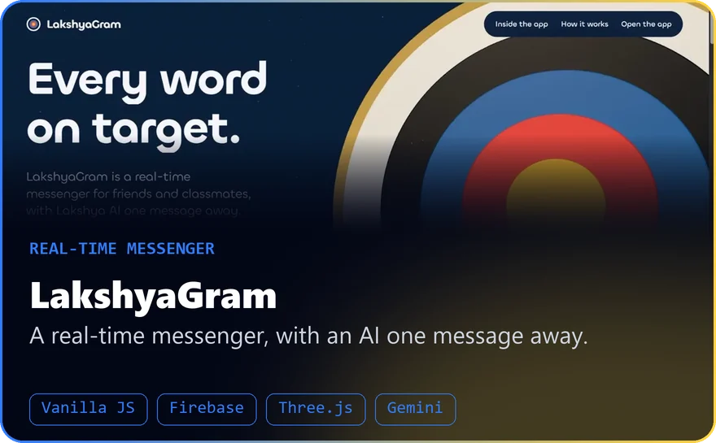</a>
       
      
      
    </td>
  </tr>
  <tr>
    <td width="50%" align="center">
      <a href="https://binarycoder3012.github.io/ATMOS/" target="_blank">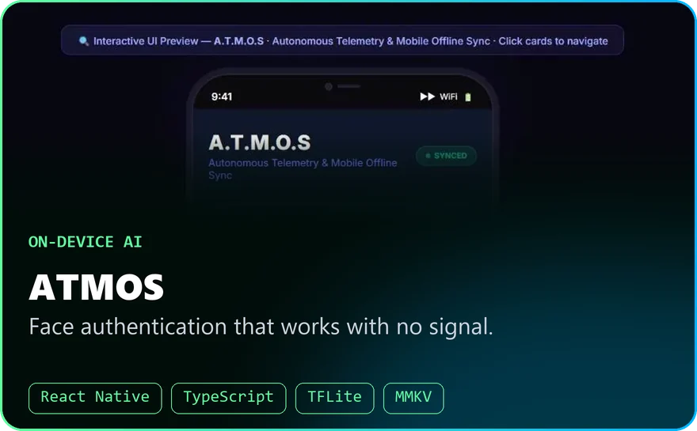</a>
       
      
      
    </td>
    <td width="50%" align="center">
      <a href="https://unigrant.vercel.app" target="_blank">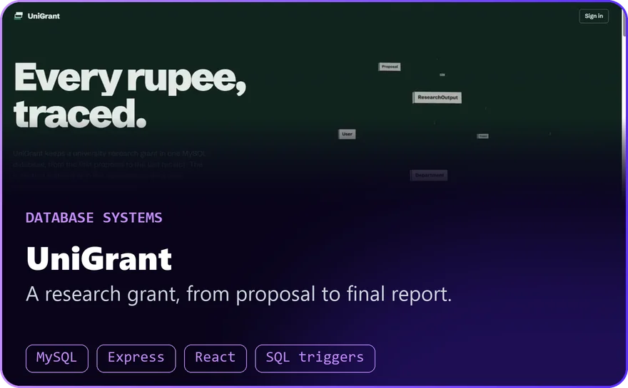</a>
       
      
    </td>
  </tr>
  <tr>
    <td width="50%" align="center">
      <a href="https://ai-project-weld-omega.vercel.app" target="_blank">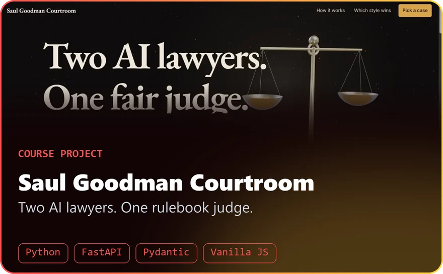</a>
       
      
    </td>
    <td width="50%" align="center">
      <a href="https://antarbodh-demo.vercel.app/" target="_blank">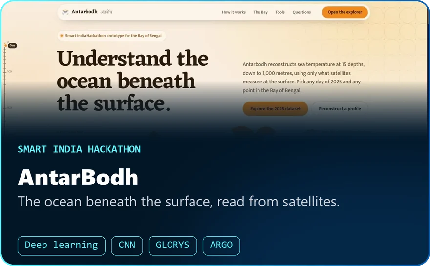</a>
       
      
      
    </td>
  </tr>
</table>

### Work

<table>
  <tr>
    <td width="33%" align="center">
      
    </td>
    <td width="33%" align="center">
      <a href="https://sibidelve.com" target="_blank">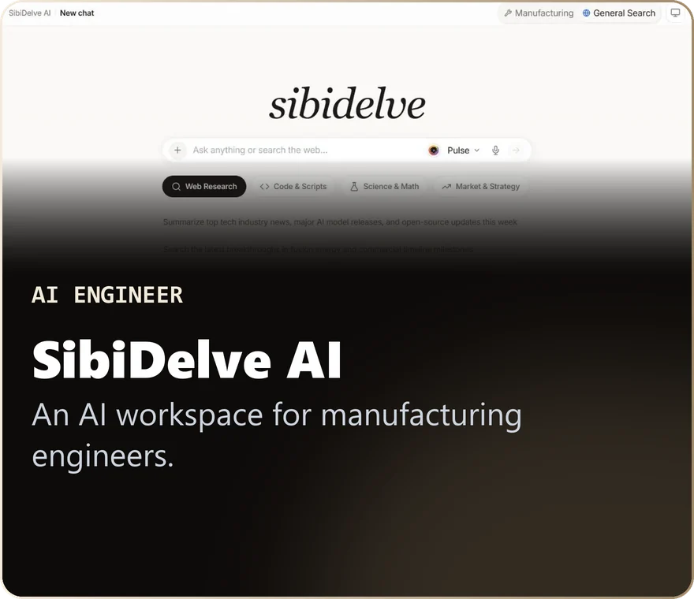</a>
    </td>
    <td width="33%" align="center">
      <a href="https://vidyarthe-models.vercel.app" target="_blank">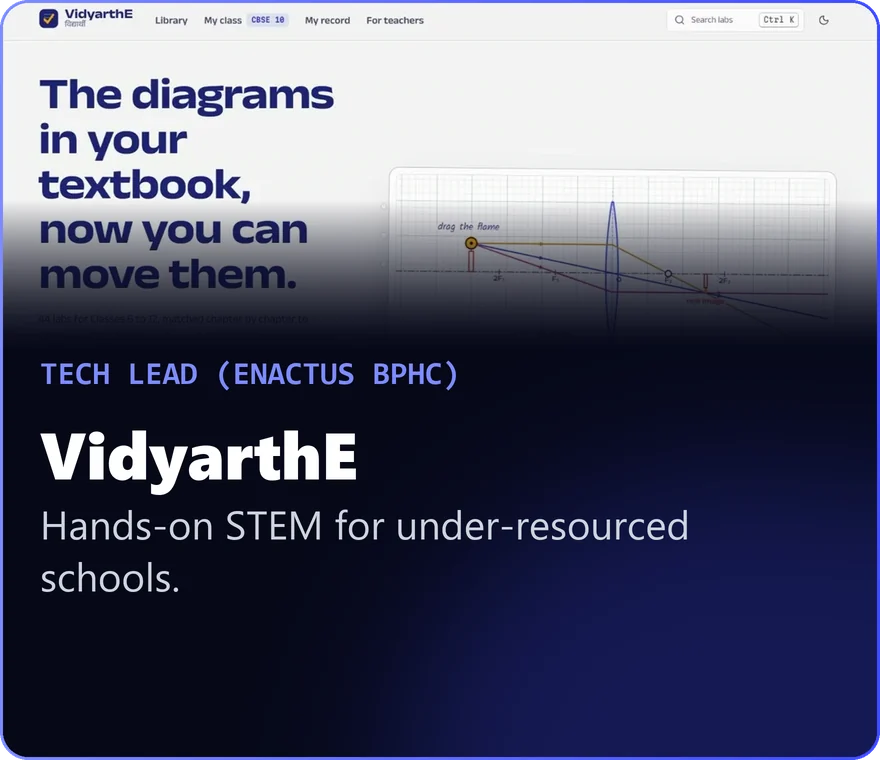</a>
    </td>
  </tr>
</table>

   
  

---

### Space Shooter

Laser-blasting my contribution tiles into oblivion.

  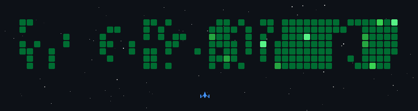

 

### Contribution City

My last 12 months on GitHub as a rotating 3D city. Each tower is a day, its height is that day's contributions, and the ring runs through the year. Cyan rooftops mark my biggest days. It rebuilds itself daily.

  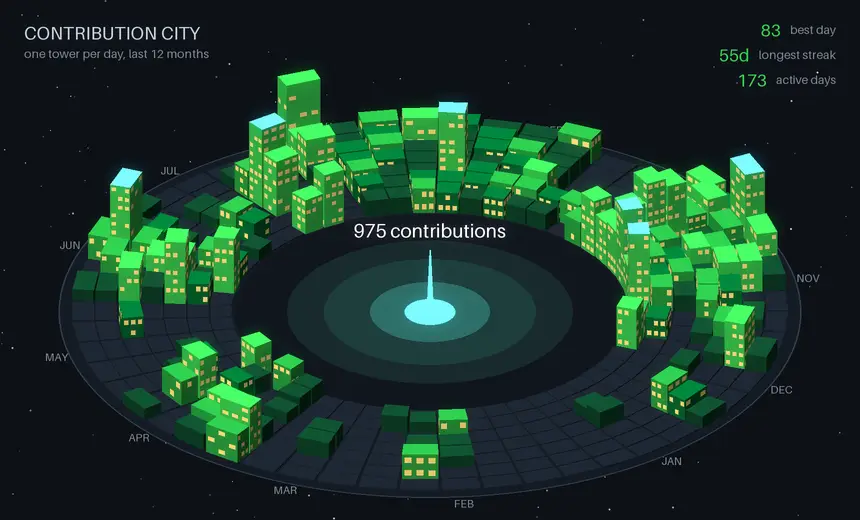

---

### Competitive Programming

  
  
  
  

  

---

### Connect

  
  
  
  

